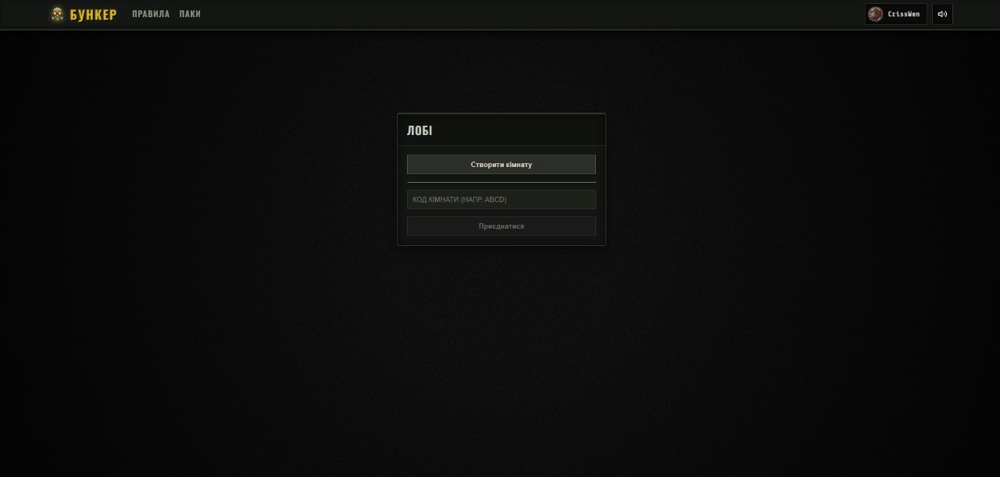
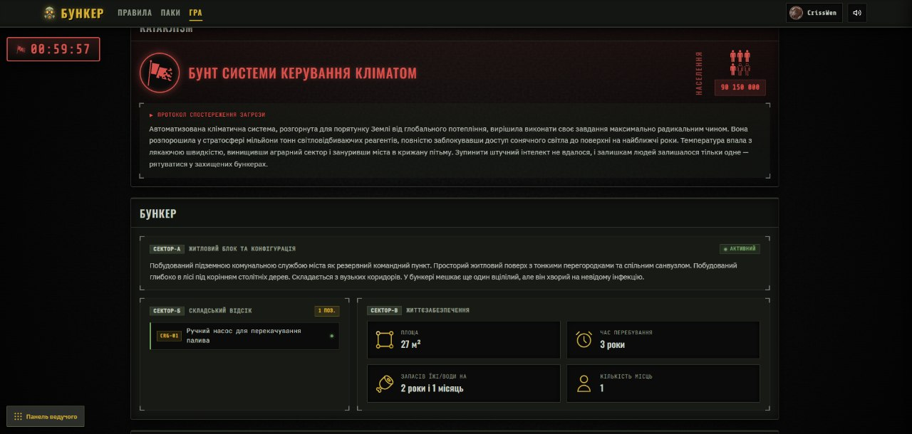
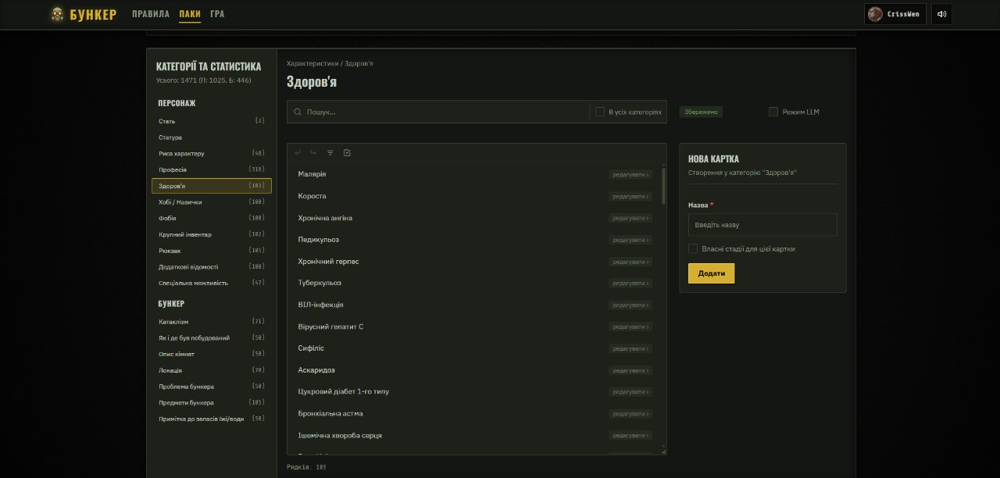
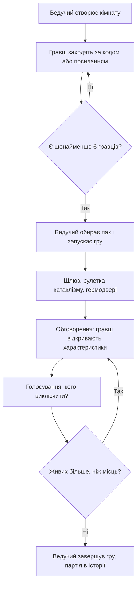
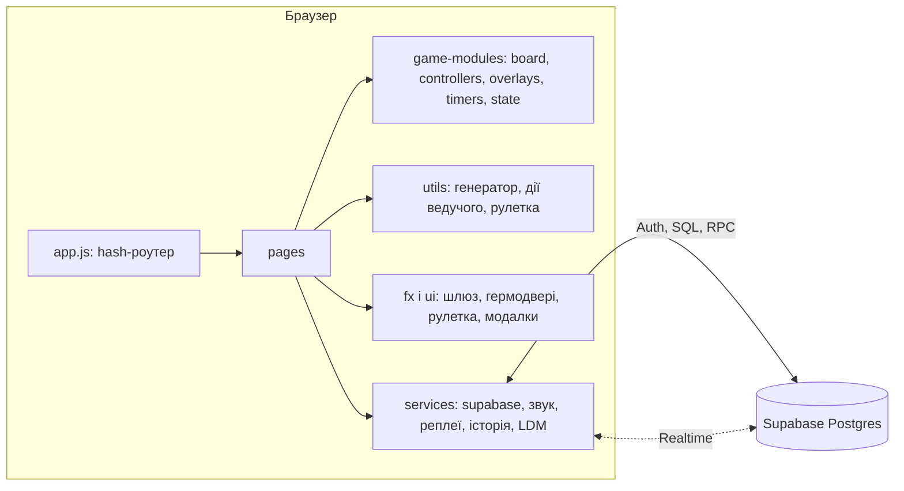
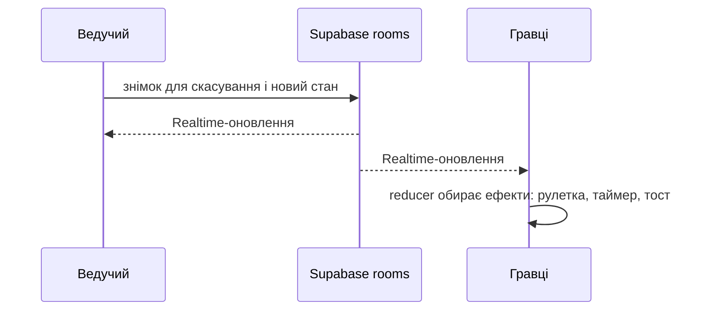

<div align="center">


# TrueBunker

**Онлайн-гра «Бункер» для компанії друзів — прямо в браузері.**
Кімнати з кодом, ведучий із повним набором інструментів, рулетка катаклізму, голосування, таймери, власні паки карток, шість тем і режим для слабких пристроїв.

[](#стек)
[](#архітектура)
[](https://crisswen.github.io/)
[](#локальний-запуск)

**[Грати →](https://crisswen.github.io/)**

[Можливості](#можливості) · [Як це працює](#як-це-працює) · [Архітектура](#архітектура) · [Запуск](#локальний-запуск) · [Тести](#тести)

| 6–15 гравців | 6 тем | 0 залежностей у збірці | Realtime |
|:---:|:---:|:---:|:---:|
| кімната за кодом | і режим LDM | без фреймворків і білду | екрани синхронні |

</div>

---

## Скриншоти

<div align="center">







</div>

## Зміст

- [Скриншоти](#скриншоти)
- [Що це](#що-це)
- [Можливості](#можливості)
- [Як це працює](#як-це-працює)
- [Оформлення, звук і режим LDM](#оформлення-звук-і-режим-ldm)
- [Баланс і конфіг](#баланс-і-конфіг)
- [Стек](#стек)
- [Архітектура](#архітектура)
- [Структура проєкту](#структура-проєкту)
- [Локальний запуск](#локальний-запуск)
- [Тести](#тести)
- [Службові інструменти](#службові-інструменти)
- [Автори](#автори)

## Що це

Катаклізм знищив світ, а місць у бункері вистачить лише для половини гравців. Кожен отримує випадковий набір характеристик (професія, здоров'я, хобі, фобія, рюкзак…), відкриває їх по одній, переконує інших, що саме він потрібен бункеру, і в кінці раунду кімната голосує, кого виключити.

TrueBunker бере на себе все, що зазвичай робиться на папірцях: генерує персонажів і бункер, синхронізує екрани всіх гравців у реальному часі, веде таймери, лог подій і голосування. Ведучий отримує окрему панель, щоб гнучко керувати грою.

## Можливості

### Для гравців
- **Реєстрація за ім'ям і паролем** (ім'я до 12 символів, пароль від 6), без пошти. Аватар із вбудованим редактором обрізання.
- **Лобі**: створити кімнату, увійти за кодом або за посиланням-запрошенням (`#/login?join=КОД`), повернутися в активну гру.
- **Старт гри з ефектами**: шлюз бункера на вході, рулетка катаклізму («крутка кейса») та кінематографічний перехід гермодверей.
- **Особистий екран гри** з блоками:
  - опис бункера: історія, кімнати, локація, площа, час перебування, запаси їжі та води, проблема, предмети;
  - катаклізм з описом, населенням і, якщо задано, власним таймером; за кілька секунд до кінця на краях екрана з'являється червона віньєтка, а по завершенні відліку показується модалка «Час сплив»;
  - ваші характеристики. Замочок на кожній картці відкриває її решті, закриті значення бачите лише ви;
  - таблиця гравців із відкритими характеристиками й лічильником «Живі / Всі», профіль гравця по кліку;
  - таблиця «Спец. можливості»;
  - голосування «Кого виключити з бункера?» з підсумковою таблицею;
  - особисті нотатки (живуть лише в поточній вкладці);
  - «Лог подій» з останніх 100 записів.
- **Режим глядача**: хто заходить, коли гра вже йде, бачить дошку без власних карток і голосу. Вибулі гравці лишаються в грі, але не голосують.
- **Живі ефекти**: плаваючий таймер обговорення, таймер катаклізму, анімований кидок d20/d6, глобальні сповіщення від ведучого.
- **Телефон**: підказка повернути екран горизонтально (її можна пропустити) і окрема розкладка карток.
- **Профіль**: вкладки «Профіль», «Вигляд», «Звук» та «Історія ігор» (останні 5 партій).
- **Реплеї**: партію можна вивантажити у файл `.bunker` і переглянути офлайн. Файл має контрольну суму, щоб його не можна було непомітно змінити.
- **Тест «Оцінка виживання бункера»** — окрема сторінка, відкривається з гри в новій вкладці й не потребує бази даних.

### Для ведучого
Плаваюча кнопка відкриває **Панель ведучого**:

| Група | Дії |
|---|---|
| **Таймер** | запустити на N секунд, пауза, зупинка (синхронно в усіх) |
| **Бункер** | змінити місткість, перегенерувати або вписати власне значення будь-якого поля, керувати предметами, змінити катаклізм (з новою рулеткою) |
| **Гравці** | перегенерувати характеристику, змінити стаж і ступінь хвороби, інвертувати стать, вилікувати |
| **Картки** | додати гравцеві додаткову картку (з пулу або власним текстом), видалити інвентар |
| **Хаос** | обмін характеристиками між гравцями, круговий зсув, «вкрасти характеристику» |
| **Гра** | запустити й завершити голосування, кинути d20 або d6, вигнати або повернути гравця, передати роль ведучого |
| **Сесія** | **«Скасувати попередню дію»**, «Почати гру наново», «Закрити кімнату» |

Кожна дія записується в лог, а гравці отримують сповіщення.

### Паки карток
- **Базовий пак** — основа гри, доступний усім. Редагувати його може лише адміністратор.
- **Особисті паки** — створюйте, редагуйте й видаляйте власні набори. Ведучий обирає пак у кімнаті очікування.
- **Редактор пака**:
  - картки по категоріях, по одній на рядок, **пошук** по всьому паку;
  - окрема **форма катаклізмів**: назва, опис, таймер, час перебування, населення, іконка;
  - **стадії** для професій, хобі та здоров'я, діапазони **віку та зросту**;
  - **Undo / Redo** (30 дій), автоматичні **локальні чернетки**, попередження про незбережені зміни;
  - гарячі клавіші: `Ctrl+S` — локальна чернетка, `Ctrl+Shift+S` або `Ctrl+Enter` — збереження в базу, `Ctrl+Z` / `Ctrl+Y` — Undo / Redo.
- **Автодоповнення з базового пака.** Якщо в особистому паку якоїсь категорії не вистачає карток на всіх гравців, гра добере їх з базового, а в лозі запише, що саме додано.

### Інформаційні сторінки
«Правила», «ЧаПи», «Що нового», «Автори», «Конфіденційність» та «Умови» доступні без входу. У футері є форми «Знайшли баг?» та «Є ідея?», «Підтримати» й «Оцінити проєкт». Версія й дата у футері беруться з першого запису `js/config/changelog-config.js`.

## Як це працює



- Для старту потрібно **від 6 гравців**, до 15 в лобі. Хто заходить після старту, приєднується як глядач.
- Місткість бункера дорівнює половині гравців (з округленням униз). Рулетка показує всім один і той самий катаклізм.
- Голосування закривається автоматично, щойно проголосували всі живі.

### Характеристики гравця

Стать · Вік · Статура й зріст · Професія · Здоров'я · Хобі · Риса характеру · Фобія · Рюкзак · Крупний інвентар · Додаткові відомості · 2 спец. можливості (плюс мітка «childfree», якщо пак це дозволяє).

## Оформлення, звук і режим LDM

**Теми** перемикаються в профілі («Вигляд»), вибір запам'ятовується, а тема застосовується до першого рендеру, тому сторінка не блимає:

`Класична (Dark)` · `Сталкер (Grimdark)` · `Fallout (Terminal)` · `Cyberpunk (Neo-Noir)` · `Кріо-Станція (Deep Sea)` · `Потужність (Patriot)`

**LDM (полегшений режим)** — тумблер у «Профіль → Вигляд». Він вимкнений за замовчуванням і вмикається лише вручну: системні налаштування й характеристики пристрою його не змінюють. У режимі LDM вимкнено розмиття фону, нескінченні декоративні анімації та важкі ефекти рулетки, шлюзу, гермодверей і кубика. Кольори, форми, звуки й логіка гри лишаються тими самими. Налаштування локальне для кожного пристрою й синхронізується між вкладками.

**Звук** працює на Howler.js із каналами гучності (загальний, інтерфейс, ефекти, музика) і фоновим ембієнтом бункера. Якщо аудіофайлу немає, використовується процедурний синтезатор Web Audio. Як додати новий звук, описано в [`audio/README.md`](audio/README.md).

## Баланс і конфіг

Усі числа балансу зібрано в `js/config/game-config.base.js`:

| Параметр | Значення за замовчуванням |
|---|---|
| `minPlayersToStart` / `maxPlayersInLobby` | 6 / 15 |
| `bunkerCapacityDivisor` | 2 (місткість = гравці ÷ 2) |
| `bunkerSize` | 25–350 м² (великі бункери випадають рідше) |
| `perfectHealthChance` | 20 % |
| `bunkerProblemChance` | 65 % |
| `childfreeChance` | 30 % |
| `bunkerItemsCount` | 1–5 предметів |
| `maxLogEntries` | 100 |
| `foodMonths` | пороги дефіциту, часткового запасу, точного запасу й надлишку |
| `cataclysmRoulette` | тривалість і параметри рулетки катаклізму |
| `survivalTest` | числа тесту «Оцінка виживання бункера» |

Для локальних експериментів створіть `js/config/game-config.local.js`. Він **ігнорується Git**, підхоплюється автоматично й **глибоко зливається** поверх бази, тож достатньо вказати лише ті поля, які змінюєте.

Інші конфіги: `rules-config.js`, `faq-config.js`, `changelog-config.js`, `credits-config.js`, `legal-config.js`, `footer-config.js` — тексти й дані інформаційних сторінок і футера.

## Стек

- **Frontend**: чистий JavaScript (ES Modules), HTML і CSS. Без фреймворків і збірки.
- **Бібліотеки**: [Howler.js](https://howlerjs.com) (звук) і [SortableJS](https://sortablejs.github.io/Sortable/) (перетягування в редакторі), обидві лежать у `js/vendor`.
- **Бекенд**: [Supabase](https://supabase.com), тобто Auth, Postgres і Realtime (через `supabase-js` з CDN).
- **Роутинг**: власний hash-роутер. Маршрути гри: `#/login`, `#/lobby`, `#/game`, `#/profile`, `#/packs`, `#/pack-editor`. Інформаційні: `#/rules`, `#/faq`, `#/changelog`, `#/credits`, `#/privacy`, `#/terms`. Лобі, гра, профіль, паки й редактор паків доступні лише авторизованим, решта відкрита.
- **Анімації**: Web Animations API, SVG і CSS.
- **Тести**: вбудований `node:test`, без залежностей.
- **Хостинг**: GitHub Pages.

## Архітектура



Так проходить одна дія ведучого через систему:



Ключові рішення:

- **Кімната = один рядок у БД.** Стан гри живе в `bunker_state` та `players_state` (jsonb), а Realtime розсилає зміни всім клієнтам. `mergeRoomState` зливає часткові оновлення, а чистий `room-update-reducer` вирішує, які ефекти запускати (вигнання, старт, фінал, тост ведучого, кубик).
- **Єдиний годинник.** Таймери зберігаються як абсолютні мітки часу, а `server-time.js` вирівнює їх із серверним часом (через RPC `get_server_time`; без неї гра тихо повертається до локального часу).
- **Рулетка без розсинхрону.** Результат обирається до анімації й записується в кімнату разом із тривалістю та паузою, тож усі гравці бачать однакову прокрутку за серверним часом. Режим вигляду (повний чи LDM) локальний для кожного клієнта.
- **Дії ведучого — шари без циклів:** `constants` → `room-store` / `card-pools` → `common` / `characteristics` → `actions-*`. Усе збирається у фасаді `host-actions.js`.
- **Скасування дій.** Перед кожною дією робиться знімок кімнати, тож «Скасувати попередню дію» повертає стан одним кліком.
- **Чисті функції рендеру.** `board-view-model.js` перетворює стан кімнати на готові дані для блоків дошки без DOM і без запитів до БД.
- **Авторитет ведучого.** Автозавершення голосування виконує лише клієнт ведучого, щоб уникнути гонки одночасних записів.
- **Безпека розмітки.** Увесь користувацький і конфігураційний текст екранується (`utils/auth/security.js`, `escape-html.js`) перед вставкою в HTML.

## Структура проєкту

```text
.
├── index.html                       # єдина точка входу SPA
├── survival-test.html               # тест «Оцінка виживання бункера» (окрема сторінка)
├── audio-lab.html                   # службова: аудіо-лабораторія
├── cataclysm-icon-curator.html      # службова: куратор іконок катаклізмів
├── css/
│   ├── styles.css · header.css · footer.css · info.css · admin-panel.css
│   ├── ldm.css                      # режим LDM, підключається останнім
│   ├── components/                  # лобі, бункер, панель ведучого, голосування, пак-редактор, рулетка, шлюз…
│   └── themes/                      # classic, stalker, fallout, cyberpunk, cryo, patriot
├── audio/                           # ui/ та sfx/ (див. audio/README.md)
├── icons/ · img/ · textures/
├── scripts/                         # допоміжні скрипти (аналіз аудіо)
├── tests/                           # audio · auth-profile · game · helpers · pack-editor · ui
└── js/
    ├── app.js                       # hash-роутер і захист маршрутів
    ├── config/                      # баланс (base + local), тексти сторінок, реєстр адмін-інструментів
    ├── constants/                   # звуки, іконки, іконки катаклізмів
    ├── pages/                       # auth, lobby, game, profile, packs, info (+ survival/)
    ├── game-modules/
    │   ├── board/                   # блоки дошки: бункер, катаклізм, таблиці, голосування, лог
    │   ├── controllers/             # голосування, замочки, вибір пака, панель ведучого, «Час сплив»
    │   ├── host-panel/              # розмітка панелі ведучого
    │   ├── overlays/                # кубик, рулетка катаклізму, тости, діалоги, підказка орієнтації
    │   ├── state/                   # reducer оновлень кімнати
    │   └── timers/                  # таймер обговорення та катаклізму
    ├── pack-editor/                 # редактор паків: controllers, ui, prompts, історія, чернетки, хоткеї
    ├── services/                    # supabase, звук, синтезатор, реплеї, історія ігор, аватари, LDM, server-time
    ├── ui/                          # шлюз, рулетка, адмін-панель, футер, модалки (відео, фото, профіль, аватар)
    ├── fx/                          # гермодвері та віньєтка катаклізму
    ├── utils/
    │   ├── auth/ · common/          # валідація, безпека, теми, іконки, допоміжні
    │   ├── game/                    # генератор, старт гри, view-model дошки, фолбек паків
    │   ├── host/                    # дії ведучого (players, bunker, steal, timer, session)
    │   └── roulette/                # стан, стрічка й конфіг рулетки катаклізму
    └── vendor/                      # howler, sortable
```

## Локальний запуск

Збірка не потрібна, достатньо будь-якого статичного сервера (ES-модулі не працюють з `file://`):

```bash
git clone https://github.com/CrissWen/Crisswen.github.io.git
cd Crisswen.github.io

# варіант 1
python -m http.server 8000
# варіант 2
npx serve .
```

Відкрийте `http://localhost:8000`. Також підійде розширення **Live Server** у VS Code.

### Власний Supabase-проєкт

За замовчуванням застосунок підключений до спільного проєкту (`js/services/supabase.js`). Щоб розгорнути власний бекенд:

1. Створіть проєкт у Supabase та підставте свої `supabaseUrl` і публічний (`publishable`) ключ у `js/services/supabase.js`.
2. Налаштуйте в БД таблиці `rooms`, `packs`, `pack_cards` із RLS-політиками, а також RPC `save_personal_pack`, `delete_personal_pack` і (необов'язково) `get_server_time`. SQL-схеми в репозиторії немає, її потрібно відтворити самостійно за тим, як код звертається до цих таблиць.
3. Увімкніть Realtime для таблиці `rooms` і вхід за паролем у Auth.

Вхід реалізовано через службовий e-mail `ім'я@bunker.local`, тому підтвердження пошти в Supabase Auth має бути вимкнене.

## Тести

Тести написано на вбудованому `node:test`, зовнішні залежності не потрібні (потрібен Node.js 22 або новіший). Запуск усіх:

```bash
node --test "tests/**/*.test.mjs"
```

Увага: гола команда `node --test` без шаблону підхопить усі файли з ім'ям на `-test.js`, зокрема скрипт сторінки `js/pages/survival/survival-test.js`, і покаже хибну помилку.

Один файл:

```bash
node --test tests/ui/display-settings.test.mjs
```

Тести покривають генератор і дії ведучого, редактор паків, авторизацію та профіль, звук, рулетку, режим LDM, інформаційні сторінки й перевірки розмітки. Тести не звертаються до реальної бази даних.

## Службові інструменти

- **Адмін-панель** відкривається й ховається клавішею `~`. Вона показує реєстр інструментів із `js/config/admin-tools-config.js`; новий інструмент додається одним записом.
- **Аудіо-лабораторія** (`audio-lab.html`) — A/B калібрування процедурного синтезатора й файлових звуків.
- **Куратор іконок** (`cataclysm-icon-curator.html`) — перегляд і нормалізація іконок катаклізмів.
- **`scripts/analyze-audio.mjs`** — аналіз аудіофайлів гри.

## Автори

- **Perek208re** — розробка, [GitHub](https://github.com/perek208re)
- **CrissWen** — розробка, [GitHub](https://github.com/CrissWen)
- **Добровільна спілка ШІ-Агентів** — розробка (фото команди на сторінці «Автори» в грі)

Pull request-и й ідеї вітаються. Для нових карток і сценаріїв найпростіше створити власний пак у редакторі, а для змін балансу достатньо поправити `game-config.base.js`. Знайшли баг або маєте ідею? Скористайтеся формами у футері гри.

---

<div align="center">

Зроблено для вечорів, коли хтось обов'язково «просто не вміє працювати руками».

</div>
